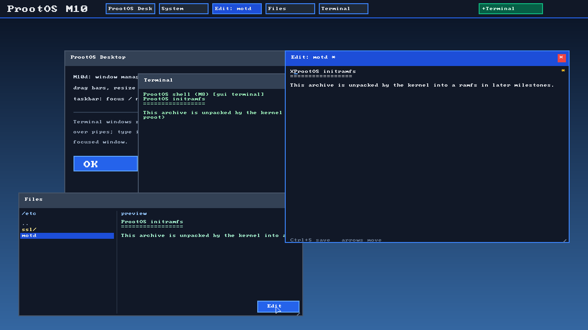

# ProotOS

A from-scratch 64-bit operating system for x86_64 UEFI, built as a demo and
research prototype. Monolithic kernel, own bootloader, own userspace.

**Status: M10g — text editor.** The kernel brings up consoles, IDT, memory,
ACPI/APIC, SMP, EEVDF, ring-3 processes, VFS/ramfs/FHS, ext2, PCI, virtio-blk,
keyboard, RTC and rtl8139. Userland: libc, `/bin/sh`, `echo`, `cat`, `ls`, `rm`,
`cp`, `mv`, `ps`, `df`. Networking: RTL8139 RX/TX, ARP, ICMP ping, DNS, HTTP `ping`/`wget`.
Packages: `/bin/ppkg` downloads the registry over HTTPS and installs/removes
tar-based `.pk` packages (`update`, `list`, `search`, `install`, `remove`),
resolving dependencies recursively (demo installs `hello`, which pulls `greet`).
TLS: mbedTLS 2.28 client, TLS 1.2, multiple HTTPS sessions per boot,
certificate and hostname verification against a Mozilla CA bundle.
Disk: AHCI SATA (`/dev/sda`) with virtio-blk fallback.
GUI: `/bin/gui` maps the GOP framebuffer into user space and implements a
small window manager: overlapping windows, z-order, focus, title-bar dragging,
corner resizing, close buttons, clipping, damage-tracked redraws, a taskbar,
multiple terminal windows with scrollback, each running `/bin/sh` over its own
pipes, a file manager with directory navigation and text preview, and a text
editor with Ctrl+S save. Input is a PS/2 IntelliMouse (buttons, wheel, Ctrl
combinations). Syscalls 85/86/88/89, `/dev/mouse`.



Known limitations: DHCP is marked ВЕРНУТЬСЯ (static SLIRP config), TLS 1.3 and
Ed25519/RSA-PSS certificate chains are unsupported by mbedTLS 2.28, the CA
bundle is a build-time snapshot, and source builds are a stub until an in-OS
compiler exists.

Package repositories:
- https://github.com/d3adp0rt/prootos-registry
- https://github.com/d3adp0rt/prootos-packages
- https://github.com/d3adp0rt/prootos-pkg-hello
- https://github.com/d3adp0rt/prootos-pkg-greet


## Requirements

- x86_64 Linux host
- `clang`, `lld`, `cmake`, `ninja`
- `qemu-system-x86`, `edk2-ovmf`
- `xorriso` (or `libisoburn`), `mtools`, `python3`

On Arch/CachyOS:

```sh
sudo pacman -S clang lld cmake ninja qemu-system-x86 edk2-ovmf libisoburn mtools
```

## Build and run

```sh
cmake -S . -B build -G Ninja
cmake --build build
python3 tools/run-qemu.py --gui          # graphical QEMU window
python3 tools/run-qemu.py --headless     # serial output only
```

Or with targets:

```sh
ninja -C build run
ninja -C build run-headless
ninja -C build test-boot
ninja -C build test-all
```

Generated artifacts live in `build/images/`:

- `BOOTX64.EFI` — UEFI loader
- `kernel.elf` — higher-half kernel
- `initramfs.cpio` — cpio newc archive
- `prootos.iso` — bootable ISO (FAT ESP + El Torito)

## Repository layout

```
boot/            UEFI loader and shared boot protocol
kernel/          kernel (arch, mm, sched, vfs, drivers, ...)
libc/            musl port (future)
user/            init, shell, coreutils, GUI, packages (future)
third_party/     vendored code (font, lwIP, mbedTLS, ...)
tools/           image builders, QEMU runner, tests
tests/           host unit tests, ktests, integration
docs/            architecture, ADRs, subsystem docs
```

## Boot flow

```
OVMF/UEFI
  -> BOOTX64.EFI: config, GOP, kernel ELF, initramfs, ACPI, memory map
  -> page tables (identity + HHDM + kernel + framebuffer)
  -> ExitBootServices
  -> kernel _start (higher half)
  -> serial + framebuffer, IDT, memory map dump
```

## Design decisions

- x86_64 kernel, IA32 userland compatibility later.
- C23 + assembly; optional `no_std` Rust.
- musl port, own syscall ABI and `ld.so`.
- ext2 read/write root, cpio initramfs, classic FHS.
- EEVDF scheduler with nice, RT and `SCHED_EXCLUSIVE` classes.
- Monolithic kernel; drivers in kernel; minimal module loader.
- No CI; local `ninja test-all` is the gate.

See `docs/` and `docs/adr/`.

## License

GPL-3.0-or-later. See [LICENSE](LICENSE).
